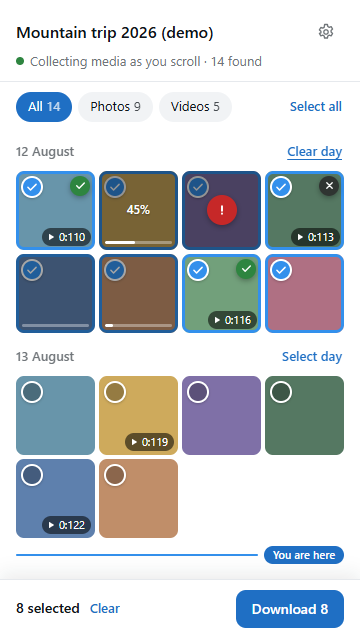
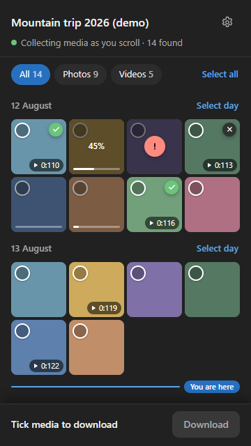
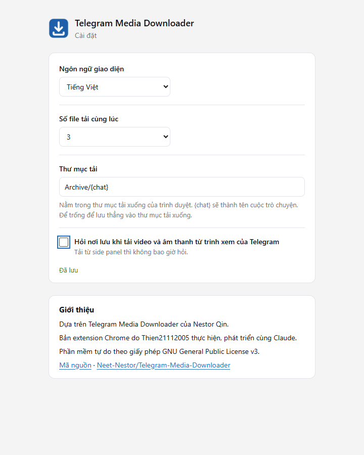

<div align="center">


# Telegram Media Downloader

**A Chrome extension that downloads photos, videos, GIFs and voice messages from Telegram Web, including chats and channels that restrict saving.**

[](./LICENSE)
[](https://github.com/Thien21112005/telegram-media-download/actions/workflows/test.yml)
[](https://github.com/Thien21112005/telegram-media-download/releases/latest)

English · [Tiếng Việt](./README.vi.md)

</div>

> This is an unofficial tool. It is not made by, affiliated with or endorsed by Telegram.

> **Status: beta (0.9).** Automated tests pass against simulated Telegram pages; the side panel has not yet been checked on every Telegram Web layout. Reports are welcome.

## Contents

- [Features](#features)
- [Install](#install)
- [Use](#use)
- [Settings](#settings)
- [Limitations](#limitations)
- [FAQ](#faq)
- [Development](#development)
- [Credits](#credits)
- [License](#license)

<p align="center">
  
  
</p>
<p align="center"><sub>Side panel with demo content: tiles show saved, downloading (45%), failed, cancelled and queued items, and the <i>You are here</i> marker.</sub></p>

## Features

- **Side panel that follows your chat.** Open the panel, scroll the chat, and every photo and video you pass appears in the panel in chat order, grouped by day. A *You are here* marker shows where you are reading.
- **Tick and download in one go.** Filter photos or videos, select a whole day, select everything, or shift-click a range, then download the selection. Each tile shows its own progress and stays marked as saved, failed or cancelled.
- **Original files, sorted into folders.** Files are saved as Telegram serves them, into `Downloads/Telegram/<chat name>/` by default, without a save dialog for every file.
- **Download buttons where Telegram hides them.** Telegram's media viewer, the story viewer and the pinned audio bar get a download button back in chats that restrict saving.
- **Progress panel in Telegram.** Shows speed, size and percentage, with Cancel and Retry; up to four downloads run at once.
- **Six languages.** English, Tiếng Việt, 简体中文, 繁體中文, Русский and မြန်မာ, following your browser language unless you pick one.

## Install

The extension is installed from a `.zip` file. It is not on the Chrome Web Store.

1. Download `telegram-media-download-v<version>.zip` from the [latest release](https://github.com/Thien21112005/telegram-media-download/releases/latest).
2. Unzip it into a folder you will keep, for example `Documents/telegram-media-download`. Chrome loads the extension from this folder, so do not delete it.
3. Open `chrome://extensions` (Edge: `edge://extensions`).
4. Turn on **Developer mode** (top right in Chrome, left sidebar in Edge).
5. Click **Load unpacked** and select the unzipped folder (the one that contains `manifest.json`).
6. Optional: click the puzzle icon in the toolbar and pin **Telegram Media Downloader**.

**Update:** download the new release, replace the files in the same folder, then click the reload icon on the extension's card in `chrome://extensions`. Reload any open Telegram tabs.

**Requirements:** Chrome 116 or newer, or a Chromium browser with side panel support such as Edge.

## Use

> Vietnamese step-by-step guide with troubleshooting: [docs/HUONG-DAN-SU-DUNG.md](docs/HUONG-DAN-SU-DUNG.md)

Open [Telegram Web](https://web.telegram.org/k/). Both versions work; `/k/` is recommended because some features (voice messages, pinned audio) exist only there.

### Download many items from a chat

1. Open a chat, group or channel.
2. Click the extension icon in the toolbar. The side panel opens next to Telegram.
3. Scroll the chat. Photos and videos appear in the panel as they come into view.
4. Tick the items you want, or use **Select day** / **Select all**. Shift-click selects a range.
5. Click **Download**.

For each item, Telegram's viewer opens for a moment so the extension can fetch the original file, then closes again. Keep the Telegram tab open until the panel shows *Finished*. The first time, Chrome may ask whether `web.telegram.org` may download multiple files; choose **Allow**.

### Download a single item

Open a photo, video or story in Telegram as usual. In chats that restrict saving, a download button appears in the viewer's toolbar (and in the video player's controls). Progress shows in a panel at the bottom right of Telegram.

## Settings

Open the gear icon in the side panel, or right-click the extension icon and choose **Options**.

| Setting | Default | What it does |
|---|---|---|
| Interface language | Browser language | Language of the panel, buttons and messages. |
| Simultaneous downloads | 2 | How many files download at once (1–4). |
| Download folder | `Telegram/{chat}` | Subfolder inside your browser's download folder. `{chat}` becomes the chat name. Leave empty to save directly into the download folder. |
| Ask where to save | On | Single videos and audio opened in Telegram's viewer open a save dialog. Downloads from the side panel never ask. |

Settings sync across your Chrome profile and apply to open Telegram tabs immediately.

<p align="center"></p>

## Limitations

- **Telegram Web must stay open** while files download. Downloads run inside the Telegram tab.
- **Large videos use memory.** Without a save dialog, the browser collects the whole file before saving it.
- **The side panel lists photos and videos.** Files, music and voice messages are not listed yet; download voice messages from the pinned audio bar in `/k/`.
- **Telegram may change its page.** The extension reads Telegram Web's page structure. If Telegram changes it, buttons may disappear or the panel may stay empty. Please [open an issue](https://github.com/Thien21112005/telegram-media-download/issues) with your Telegram version (`/k/` or `/a/`).
- **Long chats.** Telegram removes messages far from the screen. If an item scrolled far away, the panel asks you to scroll back to it before downloading.

## FAQ

**The panel says "Reload the Telegram tab to connect".**
Telegram was already open when the extension was installed or updated. Reload the Telegram tab.

**The panel stays empty while I scroll.**
Check that the chat contains photos or videos and that you are on `web.telegram.org`. If it still stays empty, Telegram may have changed its page; please open an issue.

**Where are my files?**
In your browser's download folder, under `Telegram/<chat name>/` unless you changed the folder setting. Open `chrome://downloads` to see them.

**Is my data sent anywhere?**
No. The extension has no server. It only makes the same requests Telegram Web makes, from your own browser session.

**Is this allowed?**
Only download content you have the right to keep, and respect the rights of the people who shared it.

## Development

Requirements: Node.js 22 or newer.

```bash
npm ci
npx playwright-core install chromium   # or set TEL_TEST_BROWSER to a Chromium/Edge executable
npm run check                          # syntax, manifest and locale checks
npm test                               # browser tests with simulated Telegram pages
npm run pack                           # builds dist/telegram-media-download-v<version>.zip
```

Load the `extension/` folder with **Load unpacked** while developing. Branded Chrome 137+ ignores the `--load-extension` switch the tests use, so run the tests with Playwright's Chromium (the default) or Edge (`TEL_TEST_BROWSER`).

- How the pieces fit together: [docs/ARCHITECTURE.md](docs/ARCHITECTURE.md)
- How to contribute, add a translation or cut a release: [docs/CONTRIBUTING.md](docs/CONTRIBUTING.md)
- Release notes: [CHANGELOG.md](CHANGELOG.md)

## Credits

- **Original author:** [Nestor Qin](https://github.com/Neet-Nestor), who wrote the [Telegram Media Downloader userscript](https://github.com/Neet-Nestor/Telegram-Media-Downloader) this extension is built on, including the download engine, viewer integration and the original translations. If the original script helped you, consider supporting the author through the links in the original repository.
- **Extension (this fork):** [Thien21112005](https://github.com/Thien21112005), who turned the userscript into a Chrome extension and added the side panel, batch downloads, settings and the Vietnamese translation.
- **Built with** [Claude](https://claude.com/claude-code) (Anthropic) as a coding collaborator.

## License

[GNU General Public License v3.0](./LICENSE), the same license as the original project. This is a modified version of the original work; the changes are listed in the [commit history](https://github.com/Thien21112005/telegram-media-download/commits/main) and [CHANGELOG.md](CHANGELOG.md).
