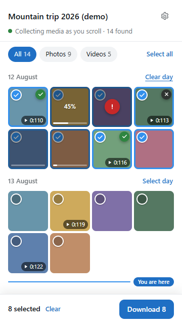
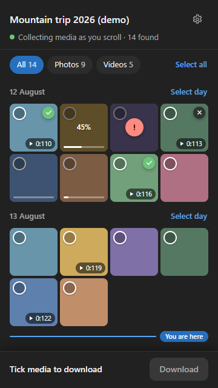

<div align="center">


# Telegram Media Downloader

**Extension cho Chrome để tải ảnh, video, GIF và tin nhắn thoại từ Telegram Web, kể cả ở những cuộc trò chuyện và kênh đã chặn lưu nội dung.**

[](./LICENSE)
[](https://github.com/Thien21112005/telegram-media-download/actions/workflows/test.yml)
[](https://github.com/Thien21112005/telegram-media-download/releases/latest)

[English](./README.md) · Tiếng Việt

</div>

> Đây là công cụ không chính thức, không do Telegram làm ra, không liên kết và không được Telegram bảo trợ.

## Mục lục

- [Tính năng](#tính-năng)
- [Cài đặt](#cài-đặt)
- [Cách dùng](#cách-dùng)
- [Cài đặt tuỳ chọn](#cài-đặt-tuỳ-chọn)
- [Giới hạn](#giới-hạn)
- [Câu hỏi thường gặp](#câu-hỏi-thường-gặp)
- [Phát triển](#phát-triển)
- [Ghi công](#ghi-công)
- [Giấy phép](#giấy-phép)

<p align="center">
  
  
</p>
<p align="center"><sub>Side panel với dữ liệu demo: các ô hiện trạng thái đã lưu, đang tải (45%), lỗi, đã huỷ, đang chờ, và vạch <i>Bạn đang ở đây</i>.</sub></p>

## Tính năng

- **Side panel đi theo cuộc trò chuyện.** Mở panel rồi cuộn chat: ảnh và video bạn lướt qua sẽ hiện trong panel theo đúng thứ tự trong chat, chia theo ngày. Vạch *Bạn đang ở đây* cho biết bạn đang đọc tới đâu.
- **Tick chọn và tải một lượt.** Lọc ảnh hoặc video, chọn cả ngày, chọn tất cả, hoặc giữ Shift để chọn một khoảng, rồi bấm tải. Từng ô hiện tiến độ riêng, sau khi xong vẫn giữ dấu đã lưu, lỗi hoặc đã huỷ.
- **File gốc, tự xếp vào thư mục.** File được lưu đúng như Telegram gửi về, mặc định vào `Downloads/Telegram/<tên chat>/`, không bật hộp thoại lưu cho từng file.
- **Trả lại nút tải ở những chỗ Telegram giấu đi.** Trình xem media, trình xem story và thanh audio ghim đều có lại nút tải ở các chat chặn lưu.
- **Bảng tiến độ ngay trong Telegram.** Hiện tốc độ, dung lượng, phần trăm, có Huỷ và Thử lại; tải tối đa 4 file cùng lúc.
- **Sáu ngôn ngữ.** English, Tiếng Việt, 简体中文, 繁體中文, Русский và မြန်မာ. Mặc định theo ngôn ngữ trình duyệt, có thể chọn tay.

## Cài đặt

Extension được cài từ file `.zip`, không có trên Chrome Web Store.

1. Tải file `telegram-media-download-v<phiên bản>.zip` ở [bản phát hành mới nhất](https://github.com/Thien21112005/telegram-media-download/releases/latest).
2. Giải nén vào một thư mục bạn sẽ giữ lâu dài, ví dụ `Documents/telegram-media-download`. Chrome chạy extension từ thư mục này nên đừng xoá nó.
3. Mở `chrome://extensions` (Edge: `edge://extensions`).
4. Bật **Developer mode** (Chế độ dành cho nhà phát triển): góc trên bên phải trên Chrome, thanh bên trái trên Edge.
5. Bấm **Load unpacked** (Tải tiện ích đã giải nén) rồi chọn thư mục vừa giải nén (thư mục có file `manifest.json`).
6. Tuỳ chọn: bấm biểu tượng mảnh ghép trên thanh công cụ và ghim **Telegram Media Downloader**.

**Cập nhật:** tải bản mới, chép đè các file vào đúng thư mục cũ, rồi bấm nút tải lại trên thẻ của extension ở `chrome://extensions`. Sau đó tải lại các tab Telegram đang mở.

**Yêu cầu:** Chrome 116 trở lên, hoặc trình duyệt nhân Chromium có side panel như Edge.

## Cách dùng

Mở [Telegram Web](https://web.telegram.org/k/). Cả hai phiên bản đều chạy được. Nên dùng `/k/` vì một số tính năng (tin nhắn thoại, audio ghim) chỉ có ở bản này.

### Tải nhiều media trong một chat

1. Mở một cuộc trò chuyện, nhóm hoặc kênh.
2. Bấm biểu tượng extension trên thanh công cụ. Side panel sẽ mở bên cạnh Telegram.
3. Cuộn chat. Ảnh và video sẽ hiện trong panel khi chúng xuất hiện trên màn hình.
4. Tick những mục muốn tải, hoặc dùng **Chọn cả ngày** / **Chọn tất cả**. Giữ Shift khi bấm để chọn một khoảng.
5. Bấm **Tải**.

Với mỗi mục, trình xem của Telegram sẽ mở ra trong chốc lát để extension lấy file gốc, rồi tự đóng. Hãy giữ tab Telegram mở cho tới khi panel báo *Xong*. Lần đầu, Chrome có thể hỏi có cho `web.telegram.org` tải nhiều file không, hãy chọn **Cho phép**.

### Tải từng media

Mở ảnh, video hoặc story trong Telegram như bình thường. Ở các chat chặn lưu, nút tải sẽ xuất hiện trên thanh công cụ của trình xem (và trong bộ điều khiển video). Tiến độ hiện ở bảng góc dưới bên phải Telegram.

## Cài đặt tuỳ chọn

Bấm biểu tượng bánh răng trong side panel, hoặc bấm chuột phải vào biểu tượng extension và chọn **Options**.

| Tuỳ chọn | Mặc định | Tác dụng |
|---|---|---|
| Ngôn ngữ giao diện | Theo trình duyệt | Ngôn ngữ của panel, các nút và thông báo. |
| Số file tải cùng lúc | 2 | Số file tải song song (1–4). |
| Thư mục tải | `Telegram/{chat}` | Thư mục con trong thư mục tải xuống của trình duyệt. `{chat}` sẽ thành tên cuộc trò chuyện. Để trống để lưu thẳng vào thư mục tải xuống. |
| Hỏi nơi lưu | Bật | Video và âm thanh mở trong trình xem của Telegram sẽ bật hộp thoại lưu. Tải từ side panel thì không bao giờ hỏi. |

Cài đặt được đồng bộ theo hồ sơ Chrome và áp dụng ngay cho các tab Telegram đang mở.

## Giới hạn

- **Phải giữ Telegram Web mở** trong lúc tải, vì việc tải chạy bên trong tab Telegram.
- **Video lớn tốn bộ nhớ.** Khi không có hộp thoại lưu, trình duyệt phải gom đủ cả file rồi mới lưu.
- **Side panel chỉ liệt kê ảnh và video.** Chưa liệt kê file, nhạc và tin nhắn thoại. Tin nhắn thoại tải được từ thanh audio ghim ở bản `/k/`.
- **Telegram có thể thay đổi trang.** Extension đọc cấu trúc trang của Telegram Web. Nếu Telegram thay đổi, nút tải có thể biến mất hoặc panel không hiện gì. Hãy [mở issue](https://github.com/Thien21112005/telegram-media-download/issues) kèm phiên bản Telegram bạn dùng (`/k/` hay `/a/`).
- **Chat dài.** Telegram gỡ những tin nhắn ở quá xa màn hình. Nếu một mục đã bị cuộn đi quá xa, panel sẽ nhắc bạn cuộn lại tới đó rồi mới tải.

## Câu hỏi thường gặp

**Panel báo "Tải lại tab Telegram để kết nối".**
Tab Telegram đã được mở từ trước khi cài hoặc cập nhật extension. Hãy tải lại tab Telegram.

**Cuộn mãi mà panel vẫn trống.**
Kiểm tra xem chat có ảnh hoặc video không và bạn có đang ở `web.telegram.org` không. Nếu vẫn trống, có thể Telegram đã đổi cấu trúc trang, hãy mở issue.

**File được lưu ở đâu?**
Trong thư mục tải xuống của trình duyệt, nằm trong `Telegram/<tên chat>/` (trừ khi bạn đổi tuỳ chọn thư mục). Mở `chrome://downloads` để xem.

**Dữ liệu của tôi có bị gửi đi đâu không?**
Không. Extension không có máy chủ. Nó chỉ gửi đúng những request mà Telegram Web vẫn gửi, từ chính phiên đăng nhập trên trình duyệt của bạn.

**Dùng như vậy có được phép không?**
Chỉ tải những nội dung bạn có quyền lưu giữ, và hãy tôn trọng quyền của người đã chia sẻ chúng.

## Phát triển

Cần Node.js 22 trở lên.

```bash
npm ci
npx playwright-core install chromium   # hoặc đặt TEL_TEST_BROWSER trỏ tới Chromium/Edge
npm run check                          # kiểm cú pháp, manifest, locale
npm test                               # test trên trình duyệt với trang Telegram giả lập
npm run pack                           # tạo dist/telegram-media-download-v<phiên bản>.zip
```

Khi phát triển, nạp thư mục `extension/` bằng **Load unpacked**. Chrome bản thường từ 137 trở lên bỏ qua cờ `--load-extension` mà test dùng, nên hãy chạy test bằng Chromium của Playwright (mặc định) hoặc Edge (`TEL_TEST_BROWSER`).

- Cấu trúc và cách các phần phối hợp: [docs/ARCHITECTURE.md](docs/ARCHITECTURE.md)
- Cách đóng góp, thêm bản dịch, phát hành: [docs/CONTRIBUTING.md](docs/CONTRIBUTING.md)
- Ghi chú phát hành: [CHANGELOG.md](CHANGELOG.md)

## Ghi công

- **Tác giả gốc:** [Nestor Qin](https://github.com/Neet-Nestor), người viết [userscript Telegram Media Downloader](https://github.com/Neet-Nestor/Telegram-Media-Downloader) mà extension này dựa trên, gồm lõi tải, phần tích hợp trình xem và các bản dịch ban đầu. Nếu script gốc có ích cho bạn, hãy cân nhắc ủng hộ tác giả qua các liên kết trong repo gốc.
- **Bản extension (fork này):** [Thien21112005](https://github.com/Thien21112005), người chuyển userscript thành extension Chrome và thêm side panel, tải hàng loạt, trang cài đặt cùng bản dịch tiếng Việt.
- **Phát triển cùng** [Claude](https://claude.com/claude-code) (Anthropic) trong vai trò cộng tác viết code.

## Giấy phép

[GNU General Public License v3.0](./LICENSE), cùng giấy phép với dự án gốc. Đây là bản đã sửa đổi từ tác phẩm gốc; các thay đổi được ghi trong [lịch sử commit](https://github.com/Thien21112005/telegram-media-download/commits/main) và [CHANGELOG.md](CHANGELOG.md).
