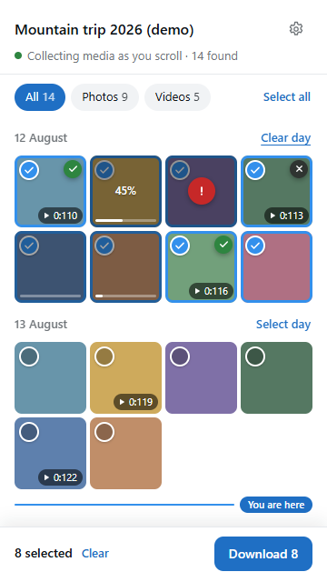
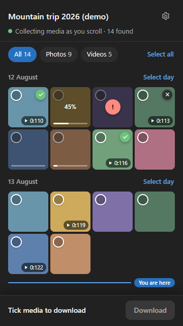
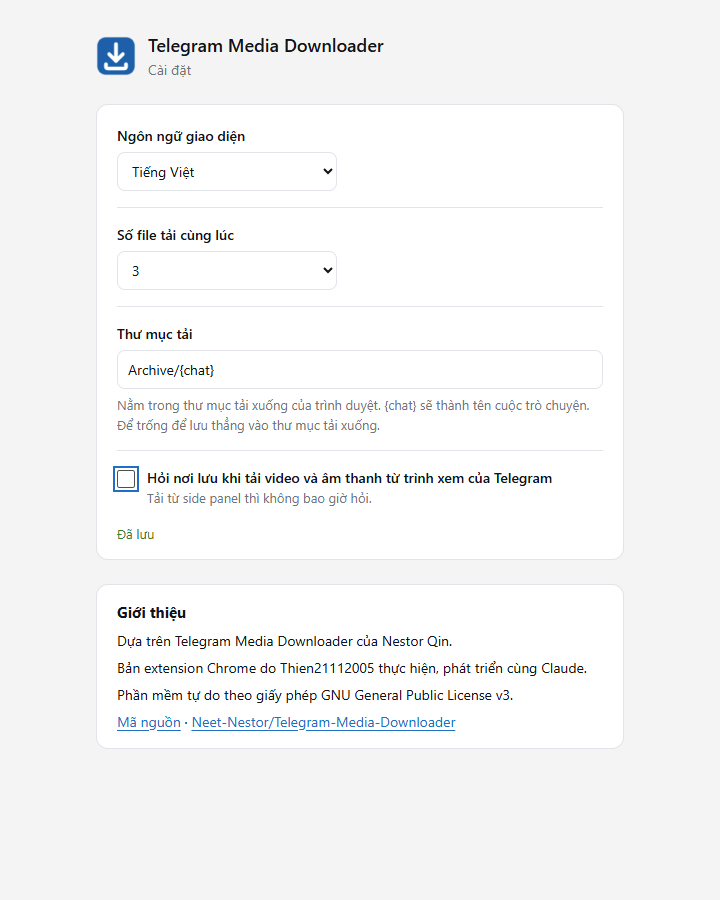

# Hướng dẫn sử dụng Telegram Media Downloader

Extension cho Chrome và Edge giúp tải ảnh, video, GIF và tin nhắn thoại từ Telegram Web, kể cả ở những nhóm hay kênh đã chặn lưu nội dung.

> Đây là công cụ không chính thức, không do Telegram làm ra. Chỉ tải những nội dung bạn có quyền lưu giữ.

  
  

## Mục lục

1. [Chuẩn bị](#1-chuẩn-bị)
2. [Cài đặt extension](#2-cài-đặt-extension)
3. [Tải nhiều ảnh, video cùng lúc](#3-tải-nhiều-ảnh-video-cùng-lúc)
4. [Tải từng ảnh, video, story, audio](#4-tải-từng-ảnh-video-story-audio)
5. [Cài đặt tuỳ chọn](#5-cài-đặt-tuỳ-chọn)
6. [File được lưu ở đâu](#6-file-được-lưu-ở-đâu)
7. [Cập nhật và gỡ cài đặt](#7-cập-nhật-và-gỡ-cài-đặt)
8. [Xử lý sự cố](#8-xử-lý-sự-cố)
9. [Mẹo dùng](#9-mẹo-dùng)
10. [Báo lỗi](#10-báo-lỗi)

## 1. Chuẩn bị

- Trình duyệt **Chrome 116** trở lên, hoặc **Microsoft Edge** bản mới.
- Tài khoản Telegram đã đăng nhập trên **Telegram Web**: https://web.telegram.org/k/
- Nên dùng bản **`/k/`** của Telegram Web. Bản `/a/` vẫn chạy được, nhưng tin nhắn thoại và audio ghim chỉ tải được ở `/k/`.

## 2. Cài đặt extension

Extension không có trên Chrome Web Store. Bạn cài bằng file `.zip` theo các bước sau:

1. Vào trang [Releases](https://github.com/Thien21112005/telegram-media-download/releases/latest) và tải file **`telegram-media-download-v<phiên bản>.zip`**.
2. Giải nén vào một thư mục để cố định, ví dụ `D:\Apps\telegram-media-download`.
   > Chrome chạy extension từ chính thư mục này. Nếu xoá hoặc di chuyển thư mục, extension sẽ ngừng hoạt động.
3. Mở trang quản lý extension:
   - Chrome: gõ `chrome://extensions` vào thanh địa chỉ
   - Edge: gõ `edge://extensions`
4. Bật **Developer mode** (Chế độ dành cho nhà phát triển):
   - Chrome: công tắc ở góc trên bên phải
   - Edge: công tắc ở thanh bên trái
5. Bấm **Load unpacked** (Tải tiện ích đã giải nén) rồi chọn thư mục vừa giải nén. Đó phải là thư mục **có file `manifest.json` ở bên trong**.
6. Bấm biểu tượng mảnh ghép 🧩 trên thanh công cụ, rồi bấm ghim 📌 cạnh **Telegram Media Downloader** để icon luôn hiện.
7. Nếu Telegram Web đang mở sẵn thì **tải lại tab Telegram** (F5) để extension kết nối.

> Chrome có thể hiện thông báo "Disable developer mode extensions" mỗi lần khởi động. Đây là cảnh báo bình thường với extension cài ngoài Store. Bấm đóng thông báo, đừng bấm Disable.

## 3. Tải nhiều ảnh, video cùng lúc

Đây là tính năng chính, dùng **side panel** nằm cạnh Telegram.

### Bước 1: Mở side panel

1. Mở Telegram Web và vào cuộc trò chuyện, nhóm hoặc kênh muốn tải.
2. Bấm **icon extension** trên thanh công cụ. Side panel sẽ mở ở bên phải màn hình.

Đầu panel hiện tên cuộc trò chuyện và dòng *"Đang gom media khi bạn cuộn · Đã thấy N"*.

### Bước 2: Cuộn để gom media

**Cuộn cuộc trò chuyện** như bình thường. Mỗi ảnh và video xuất hiện trên màn hình sẽ được thêm vào panel:

- Xếp **theo đúng thứ tự trong chat** và **chia theo ngày**.
- Video có biểu tượng ▶ và thời lượng ở góc dưới phải.
- Vạch xanh **"Bạn đang ở đây"** cho biết bạn đang đọc tới đâu trong chat.
- Chấm xanh cạnh dòng trạng thái nháy một lần mỗi khi tìm thấy media mới.

> Extension chỉ thấy những gì đã hiện lên màn hình. Muốn lấy media cũ hơn thì cứ cuộn lên tiếp.

### Bước 3: Chọn media

| Muốn | Làm thế này |
|---|---|
| Chọn một mục | Bấm vào ô đó (bấm lần nữa để bỏ chọn) |
| Chọn cả một khoảng | Bấm mục đầu, **giữ Shift** rồi bấm mục cuối |
| Chọn cả một ngày | Bấm **Chọn cả ngày** cạnh tiêu đề ngày |
| Chọn tất cả | Bấm **Chọn tất cả** |
| Chỉ xem ảnh hoặc chỉ video | Bấm **Ảnh** hoặc **Video** ở hàng lọc phía trên |
| Bỏ chọn hết | Bấm **Bỏ chọn** ở thanh dưới cùng |

Ô đã chọn có viền xanh và dấu ✓ xanh ở góc trên trái. Thanh dưới cùng hiện số mục đã chọn.

### Bước 4: Tải

1. Bấm **Tải N mục** ở thanh dưới cùng.
2. Với từng mục, Telegram sẽ **tự mở trình xem trong chốc lát rồi đóng lại**. Extension cần bước này để lấy file gốc có chất lượng đầy đủ. Bạn không cần bấm gì cả.
3. **Giữ tab Telegram mở** cho tới khi thanh dưới báo **"Xong N/N"**.
4. Lần đầu, Chrome có thể hỏi *"web.telegram.org muốn tải xuống nhiều tệp"*. Hãy chọn **Cho phép** (Allow).

Trong lúc tải, mỗi ô hiện trạng thái riêng và **không bao giờ đổi chỗ**:

| Hiển thị trên ô | Ý nghĩa |
|---|---|
| Thanh trống mờ | Đang chờ tới lượt |
| Thanh chạy + phần trăm | Đang tải |
| Dấu ✓ xanh lá ở góc trên phải | Đã lưu xong |
| Dấu ✕ tối ở góc trên phải | Đã huỷ |
| Vòng đỏ có dấu **!** ở giữa | Bị lỗi (rê chuột vào ô để xem lý do) |

Muốn dừng thì bấm **Huỷ** ở thanh dưới cùng. Mục nào lỗi thì chọn lại rồi bấm Tải lần nữa.

## 4. Tải từng ảnh, video, story, audio

Không cần mở side panel:

- **Ảnh và video:** mở như bình thường trong Telegram. Ở các kênh chặn lưu, **nút tải** sẽ hiện lại trên thanh công cụ của trình xem, và có thêm một nút trong bộ điều khiển của video.
- **Story:** mở story, nút tải nằm ở phần đầu của trình xem story.
- **Tin nhắn thoại, audio** (chỉ ở `/k/`): bấm phát, rồi bấm nút tải trên **thanh audio ghim** ở đầu khung chat.

Tiến độ hiện ở **bảng nhỏ góc dưới bên phải** trang Telegram, có các nút:

- **Huỷ**: dừng lượt tải này
- **Thử lại**: tải lại từ đầu nếu bị lỗi hoặc đã huỷ
- **Ẩn**: thu gọn bảng; việc tải vẫn tiếp tục
- **×**: bỏ thẻ khỏi bảng; việc tải vẫn tiếp tục

Ý nghĩa trạng thái cuối:

- **Hoàn tất**: file đã được ghi xong vào nơi bạn chọn.
- **Đã chuyển cho trình duyệt**: file đã được giao cho trình quản lý tải xuống của Chrome. Xem kết quả cuối ở `chrome://downloads`.

## 5. Cài đặt tuỳ chọn

Mở bằng một trong hai cách:

- bấm **bánh răng ⚙** ở góc trên phải của side panel;
- chuột phải vào icon extension, chọn **Options** (Tuỳ chọn).

| Tuỳ chọn | Mặc định | Tác dụng |
|---|---|---|
| **Ngôn ngữ giao diện** | Theo trình duyệt | Chọn Tiếng Việt, English, 简体中文, 繁體中文, Русский hoặc မြန်မာ |
| **Số file tải cùng lúc** | 2 | Từ 1 đến 4. Mạng yếu hoặc máy yếu thì để 1–2 |
| **Thư mục tải** | `Telegram/{chat}` | Thư mục con trong thư mục Downloads. `{chat}` sẽ được thay bằng tên cuộc trò chuyện. Để trống để lưu thẳng vào Downloads |
| **Hỏi nơi lưu** | Bật | Khi tải **từng** video hoặc audio từ trình xem, Chrome hỏi bạn lưu ở đâu. Tải từ side panel thì không bao giờ hỏi |

Thay đổi được lưu ngay (hiện chữ *"Đã lưu"*) và áp dụng luôn cho các tab Telegram đang mở.

Ví dụ thư mục tải:

- `Telegram/{chat}` cho ra `Downloads/Telegram/Nhóm du lịch/anh.jpg`
- `Kho/{chat}/2026` cho ra `Downloads/Kho/Nhóm du lịch/2026/anh.jpg`
- để trống cho ra `Downloads/anh.jpg`

## 6. File được lưu ở đâu

- Mặc định là **`Downloads\Telegram\<tên cuộc trò chuyện>\`**.
- Mở `chrome://downloads` (hoặc nhấn **Ctrl+J**) để xem danh sách và mở thư mục.
- Nếu trùng tên, Chrome tự đánh số thêm, ví dụ `anh (1).jpg`.
- Khi bật "Hỏi nơi lưu", video và audio tải lẻ sẽ nằm ở chỗ bạn chọn trong hộp thoại.

## 7. Cập nhật và gỡ cài đặt

**Cập nhật lên bản mới:**

1. Tải file zip của bản mới ở trang [Releases](https://github.com/Thien21112005/telegram-media-download/releases).
2. Giải nén rồi **chép đè** vào đúng thư mục cũ.
3. Vào `chrome://extensions` và bấm nút **↻** (tải lại) trên thẻ Telegram Media Downloader.
4. Tải lại các tab Telegram đang mở.

Cài đặt của bạn vẫn được giữ nguyên sau khi cập nhật.

**Gỡ cài đặt:** vào `chrome://extensions`, bấm **Remove** (Xoá) trên thẻ extension, rồi xoá thư mục đã giải nén nếu muốn.

## 8. Xử lý sự cố

| Hiện tượng | Cách xử lý |
|---|---|
| Panel báo **"Mở Telegram Web để bắt đầu"** | Tab đang xem không phải Telegram Web. Chuyển sang tab Telegram, hoặc bấm nút **Mở Telegram Web** |
| Panel báo **"Tải lại tab Telegram để kết nối"** | Tab Telegram được mở trước khi cài hoặc cập nhật extension. Bấm **Tải lại tab** |
| Panel báo **"Mở một cuộc trò chuyện để bắt đầu"** | Chọn một chat ở danh sách bên trái Telegram |
| Cuộn mãi mà panel **vẫn trống** | Kiểm tra chat có ảnh/video không. Thử tải lại tab Telegram. Nếu vẫn trống thì có thể Telegram đã đổi giao diện, hãy [báo lỗi](#10-báo-lỗi) |
| Ô báo lỗi **"Hãy cuộn chat lại tới mục này rồi thử lại"** | Telegram đã gỡ tin nhắn đó vì nó ở quá xa màn hình. Cuộn chat lại tới chỗ đó rồi tải lại |
| Ô báo lỗi **"Telegram không mở được media này"** | Media chưa tải xong phía Telegram, hoặc mạng chậm. Đợi một chút rồi tải lại |
| Lỗi **"Không nhận được dữ liệu trong 30 giây"** | Mạng bị gián đoạn. Bấm **Thử lại** |
| Chrome **chặn tải nhiều file** | Bấm icon 🚫 ở thanh địa chỉ, chọn **Luôn cho phép web.telegram.org tải nhiều tệp** |
| **Không thấy nút tải** trong trình xem | Ở kênh không chặn lưu, extension không thêm nút; dùng nút tải gốc của Telegram. Nếu kênh có chặn mà vẫn không thấy, tải lại tab |
| Máy **chậm hoặc đơ** khi tải video lớn | Giảm "Số file tải cùng lúc" xuống 1. Với video rất lớn, nên tải lẻ từ trình xem và bật "Hỏi nơi lưu" để ghi thẳng xuống ổ đĩa |
| Extension **biến mất** sau khi khởi động lại | Kiểm tra thư mục đã giải nén còn không. Kiểm tra extension còn bật trong `chrome://extensions` không |

## 9. Mẹo dùng

- **Tải cả kênh:** mở side panel trước, cuộn chat từ từ lên tới mốc thời gian muốn lấy, bấm **Chọn tất cả**, rồi bấm **Tải**.
- **Chat rất dài:** nên tải theo từng đợt, ví dụ mỗi lần vài ngày bằng **Chọn cả ngày**, thay vì gom vài trăm mục rồi mới tải.
- **Album nhiều ảnh:** mỗi ảnh trong album là một ô riêng trong panel.
- **Chỉ lấy video:** bấm bộ lọc **Video** rồi **Chọn tất cả**. Lệnh này chỉ chọn những mục đang hiện theo bộ lọc.
- **Đổi chat:** panel tự chuyển sang danh sách của chat mới. Danh sách của chat cũ vẫn được giữ trong lúc tab Telegram còn mở.
- **Đừng thao tác trong Telegram khi đang tải hàng loạt.** Extension cần mở trình xem cho từng mục, bấm lung tung có thể làm một vài mục bị lỗi (chỉ cần tải lại những mục đó).

## 10. Báo lỗi

Mở [issue mới](https://github.com/Thien21112005/telegram-media-download/issues/new?template=bug-report.md) và gửi kèm:

1. Bạn dùng Telegram **`/k/` hay `/a/`**, trình duyệt gì và phiên bản bao nhiêu.
2. Phiên bản extension (xem trên `chrome://extensions`).
3. Các bước bạn đã làm và lỗi gặp phải.
4. **Log lỗi:** ở tab Telegram, nhấn **F12**, chọn tab **Console**, rồi copy các dòng bắt đầu bằng `[Tel Download]`.
5. Nếu panel không thấy media: chuột phải vào một ảnh trong chat, chọn **Inspect**. Ở dòng được tô sáng, chuột phải và chọn **Copy → Copy outerHTML**, rồi dán vào issue.

> Đừng gửi ảnh chụp màn hình có nội dung chat riêng tư; hãy che tên và nội dung trước.

---

Extension dựa trên [Telegram Media Downloader](https://github.com/Neet-Nestor/Telegram-Media-Downloader) của **Nestor Qin**. Bản extension do **Thien21112005** phát triển cùng Claude. Phát hành theo giấy phép [GNU GPL v3](../LICENSE).
